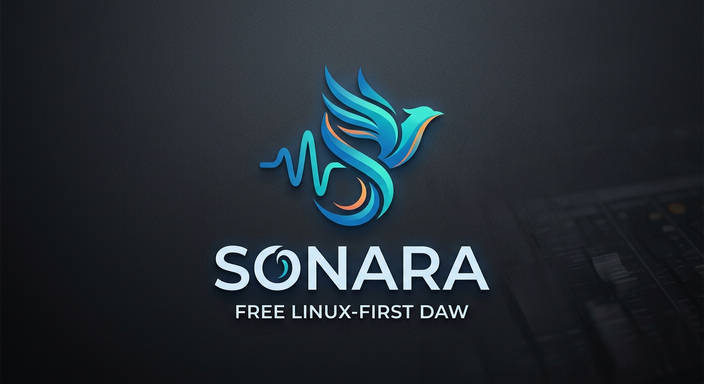
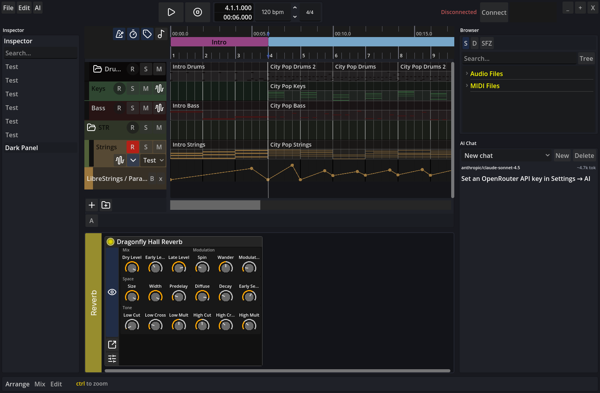

Sonara is a Digital Audio Workstation developed on and for Linux. It's a Rust audio engine and a Godot 4 UI.

The goal of sonara is to provide a seamless, frictionless UI that makes it fun to compose, arrange and mix music, while allowing high user customizability.



## At a Glance

- UI Inspired by Bitwig
- Midi editor inspired by FL Studio
- Customizable and Themeable
- Built-in support for SFZ
- Support for instrument note mapping: SFZ Keyswitches, Drum Machine, Sampler(Multisampler mode), and Instrument Layer mapping.
- VST3 + Clap plugins

## Features

- **Arranger**: MIDI and audio clips, folder tracks, group tracks, song markers, tempo changes, key changes.
- **Clip editor**: Intuitive and powerful piano-roll inspired by FL Studio.
- **Mixer**: instrument, audio and bus channels with sends, pan modes, metering and routing to hardware outputs.
- **Automation**: volume, pan, send and device-parameter lanes with linear and step curves.
- **Built-in devices**: PolySynth, a Sampler with Multisampler mode, a powerful Drum Machine (combined with Sampler Multisample mode, drum libraries can easily be set up), and a host of Note effects and audio effects like EQ, Reverb, Compressor, Delay etc.
- **CLAP and VST3 plugins**: Hosted in their own process, or shared by vendor - depending on preference.
- **Asset browser**: audio files, MIDI files, SFZ instruments and devices/plugins.
- **Undo/redo** for editing.
- **AI assistant** (optional): chat that can read and edit the project, via OpenRouter.
- **Theme system** Simple, customizable theme system.

## Current limitations

- Live Recording is not implemented yet.
- There is no support for hardware midi controllers yet.
- Only supports wav audio files.
- Themeing only supports dark mode currently.
- Linux only.

## Prerequisites

- Linux (Ubuntu/Debian/Arch/Fedora) with PipeWire, JACK or ALSA
- Rust 1.82+ ([rustup](https://rustup.rs/))
- A C/C++ toolchain, CMake and pkg-config (sfizz builds C++)
- ALSA and libsndfile headers: `sudo apt install libasound2-dev libsndfile1-dev`
  (Arch: `alsa-lib libsndfile`)
- PipeWire, D-Bus and libclang headers for the native PipeWire driver and realtime scheduling
  through rtkit: `sudo apt install libpipewire-0.3-dev libspa-0.2-dev libdbus-1-dev libclang-dev`
  (Arch: `pipewire dbus clang`)
- Godot 4.7

Optional: `liblo-tools` (`oscsend`) for OSC debugging, and `libxml2-utils` (`xmllint`) to
check DAWproject exports against the schema in tests (Arch: `libxml2`).

## Run

```bash
# Audio engine (release; debug is too slow for real-time audio)
./run_engine.sh

# UI: open Godot/ in the Godot editor, or:
godot --path Godot
```

Start the engine first. It opens the audio device, listens for OSC on UDP 7000 (replies on 7001)
and waits for Godot. Choose the output device, sample rate and buffer size in the UI's settings.

## Layout

```
Engine/            Rust audio engine, plugin host, OSC server
Godot/             Godot 4 UI
docs/subsystems/   Docs for implemented systems (keep current)
docs/adr/          Architecture decision records
docs/specs/        Feature specs (requirements, design, tasks)
docs/              Plans, research, design notes
AGENTS.md          Guide for AI coding agents (commands, architecture, conventions)
CONTEXT.md         Domain glossary
TODO.md            Backlog
STATUS.md          Notes on in-flight hard problems
```

## Development

```bash
cd Engine
cargo build --release --bins   # engine + plugin_host (both needed for CLAP)
cargo test
cargo fmt

Godot/tests/run_all.sh         # Godot tests (headless, parallel; optional name filters, -jN), from the repo root
```

`Engine/test_osc.sh`, `test_plugin_osc.sh` and `test_sfizz.sh` are OSC smoke tests against a
running engine. They make sound.

Logs: `Engine/logs/last_{info,warn,combined}.log` (rotated per session) and `Godot/logs/last.log`.

### Releasing

1. Run `scripts/gen_third_party_licenses.sh` (needs `cargo install cargo-about --locked --features cli`)
   and commit the updated `THIRD_PARTY_LICENSES`.
2. Tag the release commit (e.g. `v0.1.0-alpha`), so the source for every binary stays available.
3. Ship `LICENSE` and `THIRD_PARTY_LICENSES` with the binaries, and link the source repository
   from the download page.

See `AGENTS.md` for the architecture overview and `docs/subsystems/` for details.

## Conventions

- Middle C = C3 = MIDI 60
- 960 PPQ
- OSC is resource-based (`/channel/{id}/volume`, …). Catalog: `docs/subsystems/osc-protocol.md`

## Dependencies

Third-party libraries the project relies on. Versions are pinned in `Engine/Cargo.toml` and each
addon's `plugin.cfg`.

### Engine (Rust)

| Library | Role |
|--------|------|
| [cpal](https://github.com/RustAudio/cpal) | Audio output (PipeWire / ALSA) |
| [symphonia](https://github.com/pdeljanov/symphonia) | Decode import formats (AAC, MP3, OGG, FLAC, WAV, …) |
| [rubato](https://github.com/henquist/rubato) | Offline resampling during decode |
| [realfft](https://github.com/ejmahler/realfft) | Spectrum analyzer FFT |
| [sfizz](https://github.com/petterthowsen/rust-sfizz) (git) | Built-in SFZ sampler |
| [clack](https://github.com/prokopyl/clack) (`clack-host`, `clack-extensions`, git) | CLAP plugin hosting |
| [rosc](https://github.com/klingtnet/rosc) | OSC to/from Godot |
| [winit](https://github.com/rust-windowing/winit) + [raw-window-handle](https://github.com/rust-windowing/raw-window-handle) | Plugin GUI host windows (Linux: `x11`) |
| [libloading](https://github.com/nagisa/rust_libloading) | Dynamic CLAP library load |
| [nix](https://github.com/nix-rust/nix) / `libc` | Plugin IPC: Unix socket, shared memory, futex |
| [bincode](https://github.com/bincode-org/bincode) | Plugin IPC wire format and waveform cache |

Supporting crates (logging, serde, crossbeam, etc.) are standard plumbing; see `Engine/Cargo.toml`
for the full list.

### Godot UI

Vendored addons under `Godot/addons/`:

| Addon | Version | License | Role |
|-------|---------|---------|------|
| **GodOSC** (`godOSC`) | 0.1 | CC0 | OSC client/server in GDScript (engine comms) |
| **Godot AI** (`godot_ai`) | 4.0.4 | MIT | MCP server and editor AI tooling |

## License

Sonara is licensed under the [GNU General Public License v3.0 or later](LICENSE).
Third-party notices for everything it bundles or links are in
[THIRD_PARTY_LICENSES](THIRD_PARTY_LICENSES).

Copyright © 2026 the Sonara contributors
